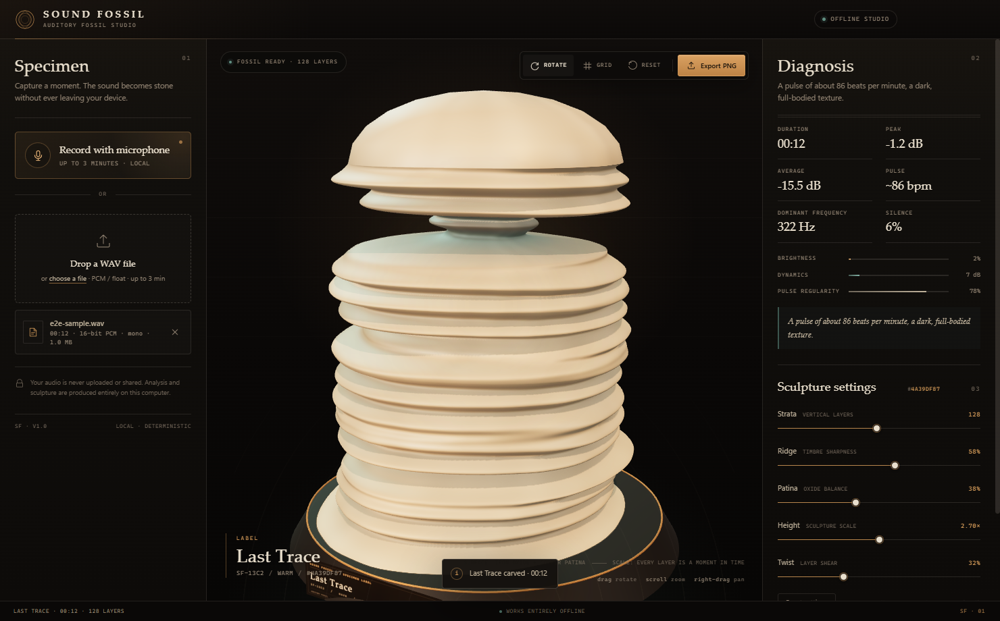
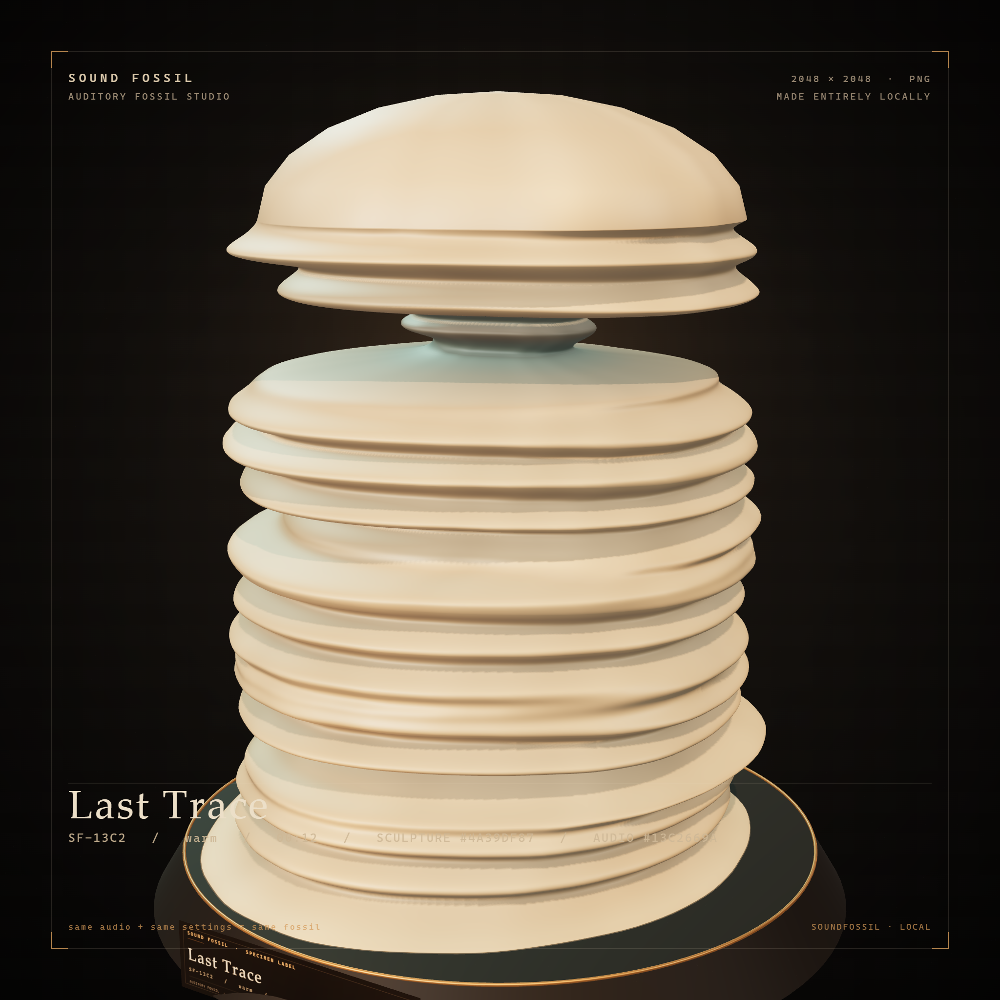

# Sound Fossil

**Sound Fossil** is an offline Windows desktop studio that turns audio recordings into deterministic, interactive 3D digital fossils.

Record a sound with your microphone or drop in a WAV file. The app measures frequency, amplitude, rhythm, timbre, and silence, then carves those measurements into a sculpture where **the same audio plus the same settings always produces the same fossil**. The body is not a stack of separate rings: it is a dense, continuously subdivided surface. The finished fossil can be rotated, zoomed, and exported as a 2048×2048 PNG.

Everything runs on your device. There is no internet connection, account, API key, or paid service.





---

## Features

- **Two ways to add audio** — record up to 3 minutes from the microphone, or import an uncompressed WAV file.
- **Continuous 3D geometry** — analysis bands are interpolated with Catmull-Rom into dense body rows, then smoothed vertically so neighboring sections never break apart.
- **Deterministic output** — the audio fingerprint and settings seed all randomness. `Math.random()` is never used, and every fossil has a reproducible geometry signature.
- **Meaningful mapping** — height follows time, thickness follows amplitude, ridges follow timbre, knots follow onsets, and narrow dark bands mark silence.
- **Live specimen diagnosis** — duration, peak, average level, pulse, dominant frequency, silence ratio, brightness, dynamics, and pulse regularity.
- **Five sculpture controls** — strata, ridge sharpness, patina, height, and twist.
- **Museum-style presentation** — a plinth, engraved specimen plaque, studio lighting, optional excavation grid, and auto-rotation.
- **High-resolution export** — a 2048×2048 PNG with the fossil's label, audio fingerprint, geometry signature, and offline-production mark.
- **Private by design** — audio never leaves the computer; the renderer is sandboxed and uses a narrow preload bridge.

## Requirements

- **Windows 10 or 11** (64-bit). Packaging is configured for Windows only.
- For running from source: **Node.js 22.12+** and npm. Development was done with Node.js 24.20.0.
- No runtime internet connection is required.

## Quick start

### Run the packaged app

Run:

```text
release\Sound Fossil-win32-x64\Sound Fossil.exe
```

No installer is required. Build the package first if the `release` directory is absent.

### Run from source

```powershell
npm install
npm start
```

`npm start` builds the renderer bundle into `dist/renderer`, then opens Electron.

### Build the Windows package

```powershell
npm run package
```

Output: `release\Sound Fossil-win32-x64\`.

The package target is `win32-x64`. The script uses Electron Packager, enables ASAR, prunes development files, and writes the application icon and Windows version metadata.

## Usage

1. **Add a specimen.** Drop a `.wav` file onto the plinth, click the drop zone to choose a file, or press **Record with microphone**. Recording starts only after you approve the in-app permission dialog and lasts at most 3 minutes.
2. **Read the diagnosis.** The right panel fills in with duration, peak, average level, pulse, dominant frequency, silence ratio, and texture meters.
3. **Shape the sculpture.**
   - **Strata** (40–220): number of analysis bands along the time axis. Each band becomes four interpolated body rows; the default of 128 bands produces 509 continuous body rows.
   - **Ridge** (0–100%): sharpness of surface lobes and veins.
   - **Patina** (0–100%): surface aging and oxide balance.
   - **Height** (1.80×–3.60×): vertical proportion of the fossil.
   - **Twist** (0–100%): rotation of body sections over time.
4. **Inspect it.** Drag to rotate, scroll to zoom, and right-drag to pan. The toolbar toggles auto-rotation and the excavation grid, resets the view, and exports the PNG. `Ctrl+E` also exports.
5. **Export.** The PNG is saved with its museum label and signatures at 2048×2048. The default filename includes the specimen code and geometry hash.

## From sound to geometry

Shapes are not random. Every feature is tied to a measured audio property:

| Audio property | Sculptural result |
| --- | --- |
| Time | Vertical axis; continuously interpolated body rows between analysis bands |
| RMS / amplitude | Body radius and volume; a base radius remains even in quiet passages |
| Spectral centroid | Direction and sharpness of lobes and veins; combines absolute timbre with within-piece change |
| Onset / pulse | Smoothed outward knots and protrusions |
| Silence | A slender, dark waist and a narrower body; never complete disappearance |
| Bass / brightness balance | A small, bounded bend of the body axis |
| Brightness / timbre | Surface color: bone, amber, and verdigris |
| Dynamic range | Patina density and surface roughness |
| Tempo regularity | Rhythmic consistency of the surface vein pattern |

A completely silent file is valid: it produces a slender "core fossil" without crashing, and the interface says so explicitly.

### Continuity and mesh topology

- Analysis bands are not stacked directly as rings. They are sampled into dense rows with Catmull-Rom interpolation, and amplitude, timbre, onset, and silence series are smoothed vertically with a short Gaussian kernel. This prevents hard radius jumps between neighboring sections.
- The body axis bends only slightly and within limits, so section centers cannot jump far enough to tear the surface.
- A chamfered lower ring seats the body on the plinth, while a soft dome and poles close the top. There is no separate center rod: the sculpture is one closed, outward-facing mesh.
- At the default settings the body has 509 rows, 57,682 vertices, and 115,360 triangles. Every edge is shared by exactly two triangles; there are no open or non-manifold edges.
- Deep silence narrows the body and darkens the patina while preserving the base radius. Silence reads as a waist, not a break.

### Determinism

- The audio fingerprint and settings together form the geometry seed.
- The PRNG and value noise use fixed seeds; `Math.random()` is not used.
- The same file plus the same settings produce the same geometry signature (hash) on every launch. The signature appears on the specimen plaque and in the PNG.
- Analysis is limited to the first 3 minutes. Longer files are truncated, and the interface displays a note explaining this.

## Tests

```powershell
npm run test:unit       # WAV decoder, analysis, and continuous geometry (28 tests)
npm run test:e2e        # Full Electron end-to-end flow (8 tests)
npm run package         # Build the Windows package
npm run smoke:package   # Launch the packaged EXE, load a WAV, and export a PNG
```

The Electron E2E test opens a real window and verifies: the empty state, WAV loading, determinism, reversible setting changes, 2048×2048 PNG content, silent WAV handling, corrupt-WAV errors, and the microphone flow. The microphone test uses Chromium's **fake audio device** (`SOUND_FOSSIL_FAKE_MIC=1`); it does not test real hardware drivers.

The E2E run also writes the documentation images to `docs/screenshots/`:

- `sound-fossil-interface.png` — the full interface after loading the showcase WAV.
- `sample-fossil.png` — the 2048×2048 PNG exported by the test.

The unit geometry tests numerically verify:

- The same audio and settings produce the same hash and identical buffers.
- Different audio and different settings produce different fossils; frequency character changes lobes and silhouette.
- Radius steps between neighboring body sections and axis shifts stay bounded.
- The mesh is closed, has no open or non-manifold edges, and encloses a positive outward-facing volume.
- The amplitude envelope is reflected in the silhouette: rising audio widens at the top, falling audio widens at the bottom.
- Completely silent audio does not crash; it produces a valid slender fossil.

Test hooks are enabled only when `SOUND_FOSSIL_TEST=1`:

- `SOUND_FOSSIL_TEST` — enables `window.__soundFossilTest` and test logging.
- `SOUND_FOSSIL_FAKE_MIC` — uses Chromium's fake microphone device.
- `SOUND_FOSSIL_EXPORT_PATH` — writes exported PNGs to a fixed path instead of opening the save dialog.

Known test limits:

- The microphone E2E test uses a fake device; latency and sampling behavior of physical microphones are out of scope.
- The PNG test checks dimensions, signature, color variety, and brightness distribution; aesthetic judgment is not automated.
- Continuity tests bound numeric radius steps and axis shifts; they do not replace aesthetic review.
- Audio analysis covers the first 3 minutes; longer recordings are intentionally truncated.

## Project layout

```text
src/
  core/
    wav.js        Dependency-free RIFF/WAVE decoder (8/16/24/32-bit PCM, 32/64-bit float, extensible)
    analysis.js   Frame-based RMS, spectral centroid, flux/onset, zero-crossing rate, tempo
    geometry.js   Continuous body mesh, feature mapping, normals, colors, geometry hash
    settings.js   Setting normalization and defaults
    names.js      Deterministic fossil names and descriptions
    format.js     English number and duration formatting
    prng.js       Seeded PRNG, hashing, and seamless noise
  main/
    main.js       Electron main process, permissions, PNG save dialog, IPC
    preload.cjs   Narrow context bridge
  renderer/
    index.html    Interface markup
    styles.css    Visual design
    app.js        Recording, import, analysis, controls, export, accessibility
    scene.js      Three.js scene, plinth, plaque, camera, PNG composition
scripts/
  build.mjs         esbuild renderer bundle
  package.mjs       Windows packaging
  smoke-package.mjs Packaged-EXE smoke test
  make-icon.mjs     Generated application icon
tests/
  unit/             WAV, analysis, and geometry tests
  e2e/              Electron end-to-end test and screenshot generation
  helpers/          WAV fixture generators
```

Technology: Electron 45, Three.js 0.186, vanilla JavaScript/CSS, and esbuild. The renderer is bundled as an IIFE so it works under `file://` without ESM or CORS issues.

## Privacy and security

- Audio files and microphone data never leave the device.
- Node integration is disabled in the renderer (`contextIsolation`, `sandbox`).
- File saving and app information go through a narrow preload bridge.
- Microphone permission is requested inside the app, and the main process grants media permission only to the trusted window.
- The Content Security Policy allows only local resources; the app makes no network requests.
- No analytics, telemetry, accounts, or crash reporting are included.

## Known limitations

- Only uncompressed WAV import is supported (no MP3, OGG, M4A, or AAC decoding).
- The file-size limit is 120 MB, and analysis covers at most 3 minutes.
- PNG export is fixed at 2048×2048 with an opaque, branded composition (no transparency).
- Video export, project save/load, and a multi-fossil gallery are not part of this release.
- Packaging is configured for Windows only. The development workflow is platform-independent, but the shipped product targets Windows.

## License

Sound Fossil is released under the [MIT License](LICENSE).

Third-party dependency licenses and Electron's bundled Chromium/Node notices are documented in [THIRD_PARTY_NOTICES.md](THIRD_PARTY_NOTICES.md). The packaged application also includes `LICENSE` and `LICENSES.chromium.html` from the Electron runtime.
